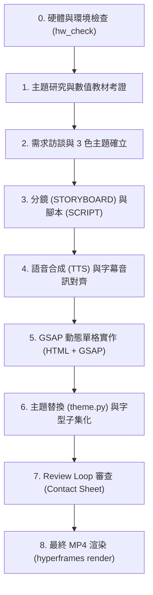

# Antigravity 原理解說動畫影片工作流（Motion Explainer）

本技能將「主題研究／教材考證 → 分鏡腳本設計 → 中文語音旁白合成 → GSAP 幾何動態設計 → 字幕音訊對齊 → 60-30-10 三色主題統整 → 字型子集化 → Contact Sheet 自我審查 → 最終 MP4 渲染」串聯為高度可靠且可重複執行的流水線。

---

## 核心技術基石

1. **HyperFrames**（HeyGen 開源）：基於 HTML + CSS + GSAP 3 驅動的現代影片渲染架構，透過 Headless 瀏覽器進行逐格精準採樣輸出。
2. **中文在地化語音（Edge-TTS / Breeze TTS）**：
   - 預設推薦：微軟台灣神經語音（`zh-TW-HsiaoChenNeural` 溫和女聲、`zh-TW-YunJheNeural` 穩重男聲），零 GPU 依賴。
   - 高階路線：Breeze TTS 2 本機語音複製與情緒控制。
3. **極簡三色主題（Theming System）**：
   - 60% 背景色（`bg`）、30% 主文字與骨幹線條（`fg`）、10% 強調關鍵與結論（`accent`）。
   - 全片統一採用開源繁體字型（預設：源石黑體 GenSeki Gothic Bold，OFL-1.1 授權）。
4. **字型子集化（Font Subsetting）**：
   - 透過 `subset_fonts.py` 自動抽取全片用字，將 15MB+ 中文字型縮減為 ~140KB，徹底消除 Puppeteer 渲染超時與記憶體耗盡。
5. **Review Loop 聯絡單審查**：
   - 自動將全片每一幀的重要節奏點抽取並合成 4x4 視覺接觸清單（Contact Sheet），一眼揪出跳動、色彩失真、重疊與錯字。
6. **教育審查整合（`g4-curriculum-review`）**：
   - 凡涉及國中小教材影片，自動銜接三階漏斗審查機制（課綱門檻、認知負荷退回檢驗、迷思診斷與在地情境），檢核通過後方可交付。

---

## 完整工作流程



---

### Step 0: 硬體與環境檢查

1. 檢查核心依賴：
   ```bash
   node -v               # 建議 v20+ 或 v22+
   ffmpeg -version       # 必須在 PATH 中
   hyperframes --version # 建議 v0.8.170+
   python3 -c "import edge_tts, fontTools, PIL; print('Python deps OK')"
   ```
2. 執行硬體推估：
   ```bash
   python3 ~/.gemini/config/skills/antigravity-motion-explainer/scripts/hw_check.py --project <專案目錄>
   ```

---

### Step 1: 主題研究與教材考證

- 依據主題蒐集最新資料，明確標示數值來源（官方宣稱、實測報導、自己推導）。
- **教材動畫守則**：若為學校教材（如南一版國小數學四上「三角形」），必須嚴格核對課綱定義（如「頂點、邊、角」、「銳角、直角、鈍角三角形」、「等腰、正三角形」與「三角形成立條件：兩邊之和大於第三邊」），嚴禁超綱或使用非課綱名詞。

---

### Step 2: 需求訪談與 3 色主題確立

確認影片規格：
- **長度**：建議 60–120 秒，依照旁白節奏定錨。
- **畫布比例**：預設 16:9（1920x1080），投影與 YouTube 首選。
- **三色色彩盤（寫入專案 `theme.json`）**：
  - 深色系範例：`"bg": "#121212"`, `"fg": "#F2F0EA"`, `"accent": "#FF7A1A"`
  - 藍黑科技系：`"bg": "#0D1117"`, `"fg": "#C9D1D9"`, `"accent": "#58A6FF"`
  - 暖色文教系：`"bg": "#1C1B1A"`, `"fg": "#EAE6DF"`, `"accent": "#FFB800"`

---

### Step 3: 分鏡與腳本設計

1. 建立專案骨架：
   ```bash
   hyperframes init videos/<專案名稱> --non-interactive --example=blank --skill=faceless-explainer
   ```
2. 抓取開源字型：
   ```bash
   bash ~/.gemini/config/skills/antigravity-motion-explainer/scripts/fetch_fonts.sh <專案目錄>
   ```
3. 撰寫 `STORYBOARD.md` 與 `SCRIPT.md`：
   - 旁白請**依「子句」切分**，每逗號即為一個動態揭示點。
   - **所有數字一律拼寫為繁體國字**（如「一萬零八百元」、「三點一四秒」），避免 TTS 誤讀。

---

### Step 4: 語音合成與字幕音訊校正

1. 合成語音：
   ```bash
   python3 ~/.gemini/config/skills/antigravity-motion-explainer/scripts/edge_tts_voice.py \
     --project <專案目錄> \
     --voice zh-TW-HsiaoChenNeural \
     --rate="-5%"
   ```
2. 建立音訊時長資訊與字幕群組：
   ```bash
   python3 ~/.gemini/config/skills/antigravity-motion-explainer/scripts/voice_meta.py <專案目錄>
   python3 ~/.gemini/config/skills/antigravity-motion-explainer/scripts/patch_captions.py <專案目錄>
   ```

---

### Step 5: 單幀動態實作（HTML + GSAP 3）

在 `compositions/frames/` 內實作各幀：
- **底層保留區規範**：畫面底部 180px（`y: 900px ~ 1080px`）保留給字幕軌道 `#cap`，主要動態內容與警告標語必須保持在 `y <= 860px` 或加入 `data-layout-allow-overlap` 屬性。
- **幾何與線條動態**：善用 SVG `stroke-dashoffset`、`transform-origin`、GSAP `Timeline` 與 `back.out(1.7)` / `power2.out` 緩動。
- **對比與易讀性**：文字與背景對比度必須符合 WCAG AA 4.5:1。

---

### Step 6: 主題統一替換與字型子集化

1. 套用三色主題：
   ```bash
   python3 ~/.gemini/config/skills/antigravity-motion-explainer/scripts/theme.py <專案目錄>
   ```
2. 抽取字集並進行中文字型子集化：
   ```bash
   python3 ~/.gemini/config/skills/antigravity-motion-explainer/scripts/subset_fonts.py <專案目錄>
   ```

---

### Step 7: Review Loop 聯絡單審查

1. 檢查佈局規範：
   ```bash
   cd <專案目錄> && hyperframes check
   ```
2. 渲染草稿並生成 Review Contact Sheet：
   ```bash
   hyperframes render --draft --output renders/draft.mp4
   python3 ~/.gemini/config/skills/antigravity-motion-explainer/scripts/sheet.py \
     --project <專案目錄> \
     --video renders/draft.mp4 \
     --beats \
     --out renders/sheets/beats.png
   ```
3. 檢查聯絡單，確認各分鏡轉場平順無突兀閃爍。

---

### Step 8: 最終高畫質 MP4 渲染

```bash
cd <專案目錄> && hyperframes render --output renders/video.mp4
```

輸出驗證：
- 畫面解析度：1080p（1920x1080）
- 音訊響度：建議落在 -16 LUFS 左右，適合課堂投影與 YouTube 串流。

---

## 關鍵踩坑與避雷手冊（Lessons Learned）

1. **`edge-tts` rate 參數解析**：
   - 傳遞負值語速（如 `-5%`）時，命令列必須使用 `--rate="-5%"` 等號語法，否則會被 Python argparse 誤判為未知 flag。
2. **`theme.py` 快取機制**：
   - `theme.py` 首次執行時會將原始 HTML 備份至 `.hyperframes/pre-theme/`。若手動修改了 `compositions/frames/` 中的 HTML，必須清空 `.hyperframes/pre-theme/` 或是直接編輯該快取，否則再次執行 `theme.py` 會覆蓋最新的手動變更。
3. **字型子集化不可省略**：
   - 未經子集化的繁體中文字型（15MB+）在無頭瀏覽器多進程並發渲染時會引發極大記憶體壓力，導致 Puppeteer 隨機逾時。務必執行 `subset_fonts.py`。
4. **教材審查不妥協**：
   - 任何中小學教材內容產出，嚴格禁止跳過 `g4-curriculum-review`，務必自我檢視定義無誤後輸出審查報告。
